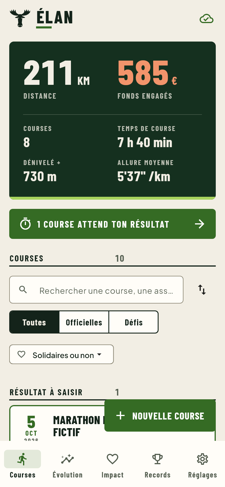
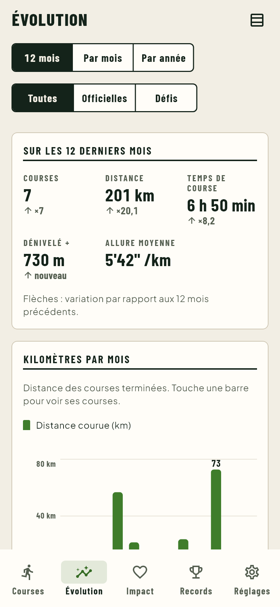
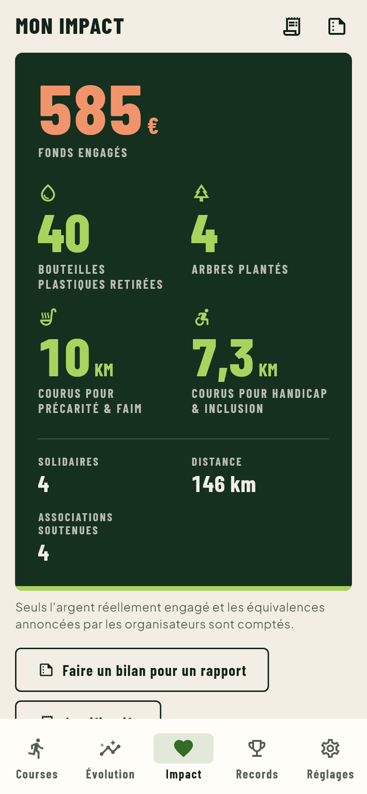
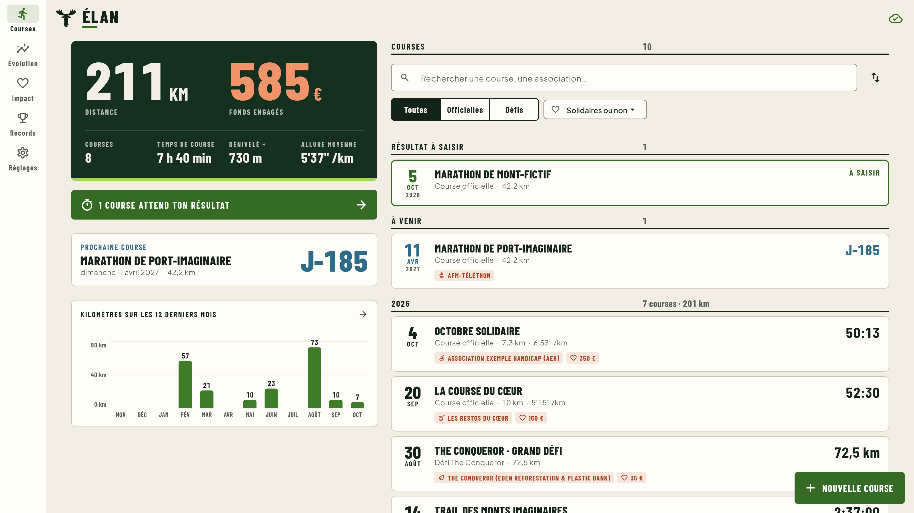
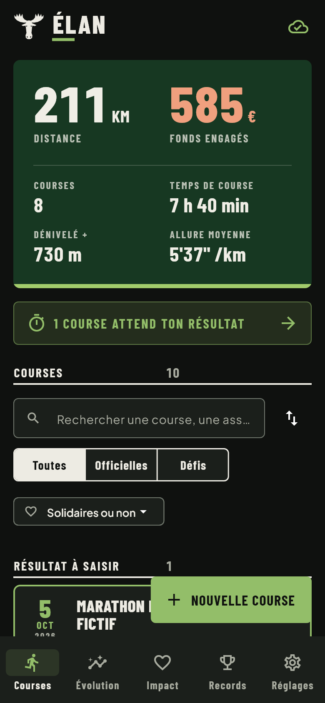
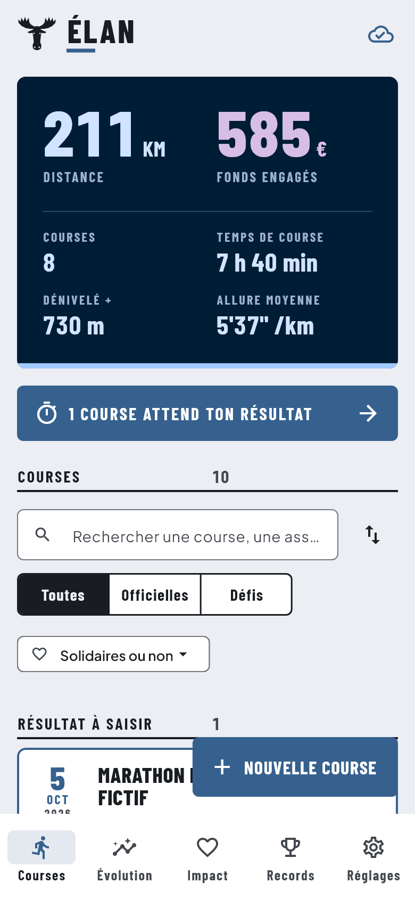
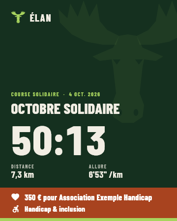

<p align="center">
  
</p>

<h1 align="center">ÉLAN · Sport & Impact</h1>

<p align="center">
  Le carnet de course qui compte aussi ce que tes kilomètres rapportent aux autres.<br>
  Windows · Android · synchronisé entre tes appareils.
</p>

<p align="center">
  
  
  
</p>

## Ce que fait l'app

**Courses**
- Toutes tes courses officielles et tes défis (The Conqueror…), avec temps, allure, dénivelé, photos du dossard et de la médaille.
- **Courses à venir** : inscris-les à l'avance ; le jour J, elles passent en « résultat à saisir ».
- Import d'un fichier **GPX** (distance, durée, dénivelé).
- Liste en blocs (à saisir, à venir, puis par année), recherche et filtres : *Officielles / Défis* et *Solidaires / par cause*.

**Évolution**
- Bilan de la période avec la variation par rapport à la précédente.
- Kilomètres par mois (12 derniers mois ou une année au choix) ou par année ; touche une barre pour voir ses courses.
- Cumul de l'année comparé à l'année précédente, allure de chaque course officielle, vue tableau.

**Impact**
- L'argent réellement engagé (parrainage au km, don à l'inscription, collecte).
- Les équivalences **annoncées par les organisateurs** (arbres, bouteilles…), et pour chaque autre cause, les kilomètres courus pour elle. Rien n'est extrapolé.
- Fonds engagés par année, par cause, associations soutenues (catalogue intégré + répertoire officiel des associations).

**Records** : meilleurs temps sur 5 km, 10 km, semi et marathon, plus longues distances, plus gros dénivelés.

**Partage** : une carte image de la course (1080 × 1350), prête pour les réseaux.

**Pratique**
- Import de plusieurs fichiers GPX d'un coup (Garmin, Strava…), doublons ignorés.
- Widget Android : prochaine course avec son compte à rebours, kilomètres de l'année.
- Sauvegarde automatique chaque semaine sur ordinateur (courses en Excel, photos et justificatifs).
- L'app signale toute seule les nouvelles versions.

**Partout**
- Hors ligne d'abord : tout fonctionne sans réseau, la synchronisation se fait dès que possible.
- Mode clair, sombre ou système ; sur Android, **Material You** (couleurs du fond d'écran) et icône à thème.
- Accessibilité : contrastes vérifiés (WCAG), textes agrandis à 200 %, lecteurs d'écran, animations réductibles.

<p align="center">
  
</p>
<p align="center">
  
  
  
</p>

## Installer

Chaque version publie ses fichiers dans les *Releases* du dépôt, prêts à installer :

| | |
|---|---|
| **Windows** | `ELAN-Installation-v….exe` : double-clic, Installer. |
| **Android** | `ELAN-v….apk` : à ouvrir sur le téléphone. |
| **Serveur personnel** | `ELAN-serveur-v….zip` : un dossier à déposer sur son NAS, voir plus bas. |

Depuis le code : `Installer ELAN.cmd` (Windows) et `Construire APK Android.cmd` (Android).

Pas à pas complet (dont la première installation des outils Android) : **[docs/INSTALLATION.md](docs/INSTALLATION.md)**.

Avant la première installation, l'app doit être reliée à son projet Supabase (base, comptes, photos) :
**[docs/CLOUD.md](docs/CLOUD.md)**. L'accès se fait par e-mail et mot de passe, sur invitation uniquement.

**Héberger son propre serveur** (NAS avec Docker) : un seul conteneur, un seul fichier à déposer,
rien à configurer. Dans l'app, il suffit d'indiquer son adresse ; le premier compte se crée depuis
l'app. Paquet `ELAN-serveur-vX.zip` joint à chaque version, guide pas à pas pour débutants :
**[serveur/LISEZMOI.md](serveur/LISEZMOI.md)**.

## Développer

Prérequis : Flutter (stable) et `config/supabase.json` rempli (modèle : `config/supabase.example.json`, jamais commité).

```powershell
flutter run -d windows --dart-define-from-file=config/supabase.json   # lancer l'app
flutter test                                                           # tests
flutter test --tags screenshots --run-skipped --update-goldens         # captures de relecture (test/screenshots/out)
dart run build_runner build                                            # après une modification des tables Drift
```

| Brique | Choix |
|---|---|
| Interface | Flutter, Riverpod, go_router |
| Données locales | Drift (SQLite), une base par compte |
| Serveur | En ligne : Supabase (authentification, Postgres avec sécurité par ligne, stockage privé). Personnel : PocketBase, un conteneur Docker |
| Synchronisation | Hors ligne d'abord, la modification la plus récente gagne, suppressions propagées |

Architecture, règles métier et charte graphique : **[docs/ARCHITECTURE.md](docs/ARCHITECTURE.md)**.
Prochaines évolutions et leur état : **[docs/FEUILLE_DE_ROUTE.md](docs/FEUILLE_DE_ROUTE.md)**.
Accessibilité (RGAA) : **[docs/ACCESSIBILITE.md](docs/ACCESSIBILITE.md)**.

```
lib/
  app/        thème, navigation, composants et graphiques communs
  core/       base locale, synchronisation, photos, choix du serveur
  features/   courses · evolution · impact · records · report · documents · settings · auth
  l10n/       textes (français)
serveur/      serveur personnel : un conteneur Docker pour NAS, et son guide
supabase/     structure de la base du serveur en ligne
scripts/      installation Windows (script et installateur), construction de l'APK
.github/      fichiers de chaque version (APK, installateur, serveur), test du serveur
```

## Versions

Chaque version est marquée par une étiquette Git (`v2.9.0`…) ; ses fichiers sont dans les *Releases*
du dépôt. Ce dépôt public reçoit un commit par version (`scripts/publier.sh`).

## Licence

ÉLAN est un logiciel libre, distribué sous licence **GNU GPL version 3** (fichier [LICENSE](LICENSE)) :
tu peux l'utiliser, l'étudier, le modifier et le redistribuer, à condition que les versions
redistribuées restent libres, sous la même licence. Il est fourni sans garantie.

Polices : Barlow Condensed et Plus Jakarta Sans, sous licence SIL Open Font License (`assets/fonts`).
